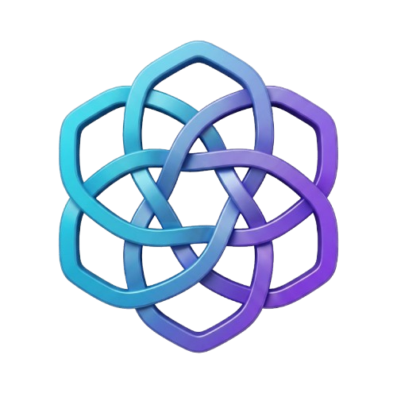

# Aidy



**A voice assistant for Windows, built with Python and C# / WPF.** Aidy listens for spoken commands and helps users interact with desktop applications. In this version, an optional Google Gemini API mode interprets requests as structured tasks before Aidy checks and executes supported actions.

## What it can do

- Recognize voice commands and open applications or control windows.
- Interpret supported requests with Gemini and carry out bounded desktop actions.
- Navigate files and folders, use browser controls, and create or edit documents using supported operations.
- Keep the original interpretation mode available alongside the API mode.

The project was developed collaboratively with the assistance of AI tools. See the [version notes](api_added_v1.md) for the detailed feature list and current limitations.

## Getting started

Requirements: Windows x64, .NET 8 SDK, Python 3.10–3.12 x64 and a microphone. API mode also needs Google API credentials and network access. The setup script installs Python dependencies, prepares speech models and builds the application.

From PowerShell in the project directory:

```powershell
cd Aidy-main/WpfApp1
.\setup.ps1
.\Configure-AidyCredentials.ps1
.\Set-AidyInterpretation.ps1 -Mode api
.\Start-Aidy.ps1
```

Configure credentials locally; do not commit API keys or personal voice profiles. See [Google AI integration](Aidy-main/WpfApp1/AI_INTEGRATION.md) and [desktop agent documentation](Aidy-main/WpfApp1/UNIVERSAL_AGENT.md) for configuration and supported actions.

## Status and limitations

This is a development version. Actions depend on the target application, Windows accessibility support and the API response; multi-step tasks are not universally reliable. The [version notes](api_added_v1.md) report 443 passing tests and a successful Release build, alongside an end-to-end Notepad test that did not pass because cloud planning requests failed or timed out. Those results are reported by the project and are not a guarantee for every environment.

## Technology

Python · C# · WPF · Google Gemini API · speech recognition · Windows UI Automation

The application source is in [`Aidy-main/WpfApp1`](Aidy-main/WpfApp1).
